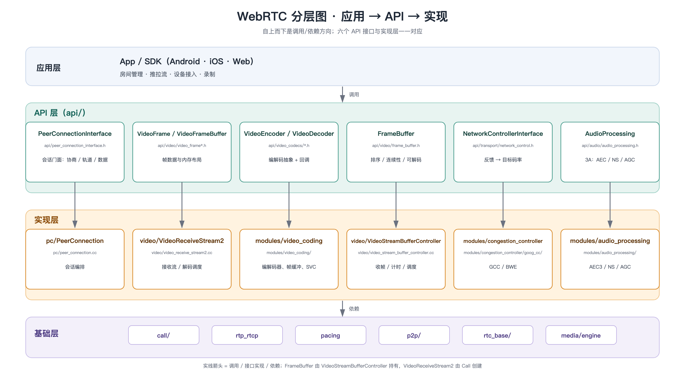
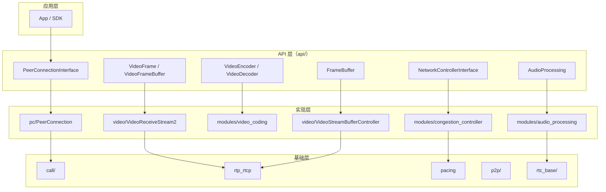

# api 分层图（应用 → API → 实现）

> 对应 D1 产出。图片：`api-分层图.png`；矢量源：`api-分层图.svg`。

## 1. 怎么读这张图

- **自上而下**是调用/依赖方向：应用 → API → 实现 → 基础层。
- **API 层每个框**对应一个公开接口，**实现层正下方的框**是它的主要实现。
- 实线箭头表示「调用 / 接口实现 / 依赖」，不表示完整数据流。

## 2. API → 实现 对照

| API 接口 | 实现位置 | 说明 |
|---|---|---|
| `PeerConnectionInterface` | `pc/PeerConnection` | 会话门面：协商、轨道、DataChannel |
| `VideoFrame` / `VideoFrameBuffer` | `video/VideoReceiveStream2` | 帧数据进入接收流，再做解码调度 |
| `VideoEncoder` / `VideoDecoder` | `modules/video_coding` | 编解码抽象与具体 codec 实现 |
| `FrameBuffer` | `video/VideoStreamBufferController` | controller 持有 FrameBuffer，负责收帧与调度 |
| `NetworkControllerInterface` | `modules/congestion_controller` | GoogCC / BWE |
| `AudioProcessing` | `modules/audio_processing` | AEC3、NS、AGC |

## 3. 关键关系

- `PeerConnection` 是门面，不转发媒体、不做编解码。
- `VideoReceiveStream2` 由 `Call::CreateVideoReceiveStream` 创建，内部持有 `VideoStreamBufferController`。
- `FrameBuffer` 是线程不安全的数据结构，由 controller 在 network 线程访问。
- `Call`、`rtp_rtcp`、`pacing`、`p2p/`、`rtc_base/` 是更底层的依赖。

## 4. Mermaid 源（Obsidian 可直接渲染）

## 5. 面试 2 分钟讲法

> 这张图分四层。应用层只依赖 `api/` 里的接口；API 层是稳定契约，比如 `PeerConnectionInterface`、`FrameBuffer`、`NetworkControllerInterface`；实现层按职责拆成 `pc/` 会话、`video/` 接收流与缓冲、`modules/` 编解码与拥塞控制；最下面是 `call/`、`rtp_rtcp`、`pacing`、`p2p/` 这些基础件。这样拆的好处是接口稳定、实现可替换，比如换拥塞控制算法只需要换 `NetworkControllerInterface` 的实现。
