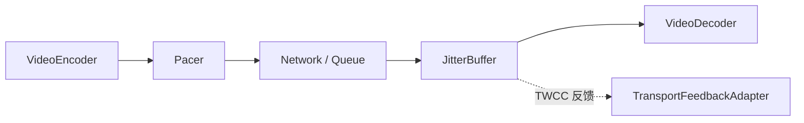
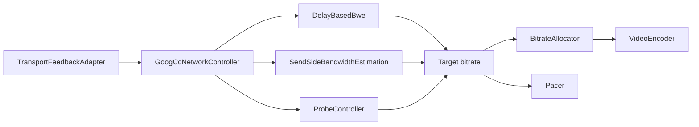
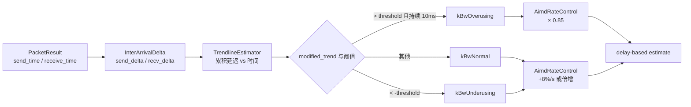
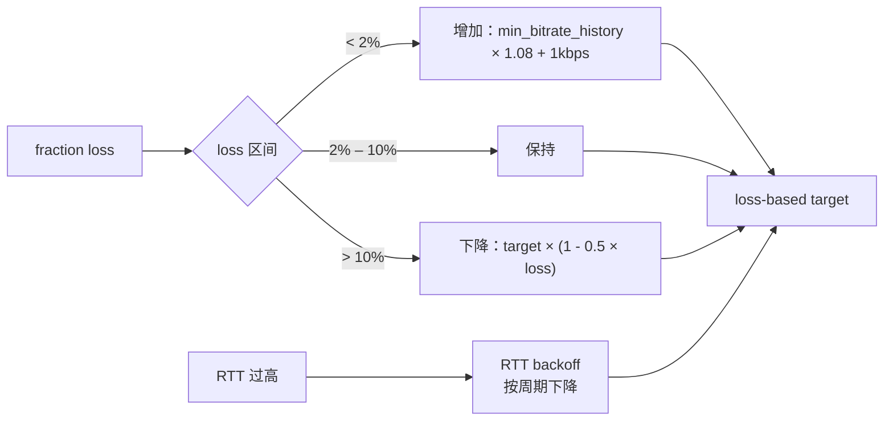

# GCC 控制环（模板）

> 对应 D5 产出。先照着画一遍，再把每个框替换成你读到的类/函数。
> 详细资料：[GCC / TWCC / 弱网](../topics/GCC-TWCC-弱网.md)

## 1. 数据与反馈路径



## 2. 控制与决策路径



### 合起来看

```
编码 → Pacer → 网络 → JitterBuffer → 解码
                 ↑
            TWCC 反馈
                 ↓
     TransportFeedbackAdapter
                 ↓
        GoogCcNetworkController
          ├─ DelayBasedBwe
          ├─ SendSideBandwidthEstimation
          └─ ProbeController
                 ↓
            Target bitrate
             ├─ BitrateAllocator → 编码器
             └─ Pacer
```

### 读图顺序

1. 编码器按目标码率出帧。
2. Pacer 按 pacing rate 平滑发送，避免突发。
3. 包经过瓶颈链路，产生排队/丢包/延迟。
4. 接收端记录每个包的到达时间，通过 TWCC 回传。
5. `TransportFeedbackAdapter` 把 TWCC 还原成 `TransportPacketsFeedback`。
6. `GoogCcNetworkController` 同时跑延迟、丢包、probe 三个模块。
7. 合成目标码率，交给 `BitrateAllocator` 和 `Pacer`。

## 3. 延迟控制器内部



### 要能解释的三个点

- **trendline 拟合的是什么**：累积延迟随时间的变化趋势，而不是单次延迟。
- **为什么要持续 10ms**：避免单个尖刺误判 overuse。
- **阈值为什么自适应**：网络基线会变，固定阈值会误判；范围 6–600ms。

## 4. 丢包控制器内部



## 5. 合成规则（要能背）

```
target = min(
  loss_based_target,
  delay_based_limit,
  receiver_limit,      // 若启用
  max_configured
)
```

当前代码里：

- `SendSideBandwidthEstimation::GetUpperLimit()` 取 `delay_based_limit_`、`receiver_limit_`、`max_bitrate_configured_` 的最小值。
- `UpdateTargetBitrate()` 再把 loss-based 的结果 clamp 到这个上限。
- 所以延迟控制器更像「上限」，丢包控制器负责主要增减。

## 6. 源码对照表

| 框 | 文件 | 关键函数 |
|---|---|---|
| TWCC 解析 | `modules/congestion_controller/rtp/transport_feedback_adapter.cc` | `ProcessTransportFeedback`、`ToTransportFeedback` |
| 总控制器 | `modules/congestion_controller/goog_cc/goog_cc_network_control.cc` | `OnTransportPacketsFeedback`、`MaybeTriggerOnNetworkChanged` |
| 延迟控制器 | `modules/congestion_controller/goog_cc/delay_based_bwe.cc` | `IncomingPacketFeedbackVector`、`MaybeUpdateEstimate` |
| 趋势检测 | `modules/congestion_controller/goog_cc/trendline_estimator.cc` | `Update`、`Detect`、`UpdateThreshold` |
| AIMD | `modules/remote_bitrate_estimator/aimd_rate_control.cc` | `Update`、`ChangeBitrate` |
| 丢包控制器 | `modules/congestion_controller/goog_cc/send_side_bandwidth_estimation.cc` | `UpdateDelayBasedEstimate`、`UpdateLossBasedEstimator`、`GetUpperLimit` |
| Probe | `modules/congestion_controller/goog_cc/probe_controller.cc` | `RequestProbe`、`Process` |
| 分配 | `call/bitrate_allocator.cc` | `AllocateBitrate` |
| 发送节奏 | `modules/pacing/pacing_controller.cc` | `ProcessPackets` |

## 7. 自检

- [ ] 能不看图说出「TWCC → target bitrate」的 6 步
- [ ] 能解释 trendline 为什么比单次延迟可靠
- [ ] 能说出 2% / 10% 两个阈值的作用
- [ ] 能解释为什么延迟估计是「上限」
- [ ] 能说出 probe 在什么时机触发

## 8. 填空版（自己画）

把下面每个空替换成你读到的类/函数：

```
编码器：__________
发送整形：__________
反馈解析：__________
总控制器：__________
延迟控制器：__________
丢包控制器：__________
探测：__________
目标码率合成：__________
分配：__________
```
